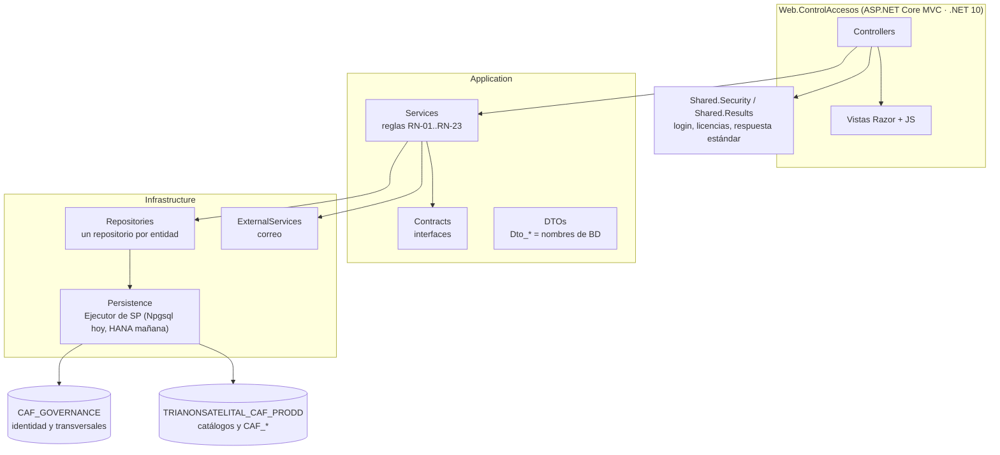
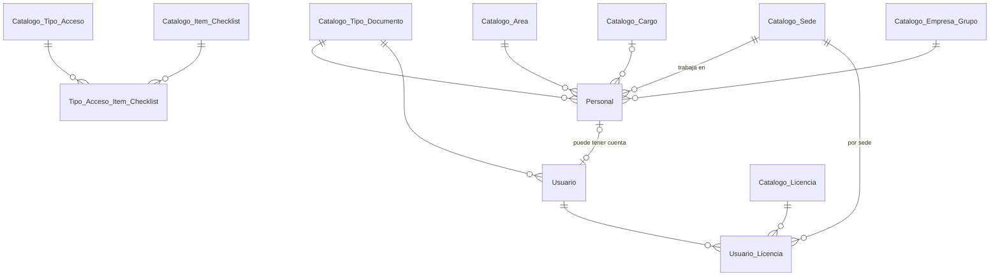

# Paquete de diseño · Hitos 0 y 1 · Base y catálogos

Proyecto **Control de Accesos** · V1.1 · 2026-10-11
Estado: **aprobado** (OK Arquitectura y OK Hito del 2026-10-11) · Fase 1 de los Hitos 0 y 1 hecha · DDL **CANDIDATO**, probado en PostgreSQL 16.15; pendiente de traducción y prueba en SAP HANA.

Este paquete deja lista la base del sistema: la solución, los dos schemas, la identidad (usuarios y licencias) y todos los catálogos que necesitan las pantallas de la etapa 1. Las tablas transaccionales (solicitud, ingreso, desviación, incidencia) llegan en los hitos 2 a 4.

Documentos de referencia: requisitos de la etapa 1 (RF, HU y RN), mockup validado y procedimientos G-PSCA-002 y G-PSCA-003.

---

## 1. Decisiones de este paquete

| # | Decisión | Motivo |
| --- | --- | --- |
| D-01 | Proyecto independiente que sigue las convenciones de Trianon Satelital (nombres, tipos, auditoría, borrado lógico, SP `ERP_*` con contrato 100/101/400/404/409/500, capas sin ORM). | Una futura integración debe ser una mudanza, no una reescritura. |
| D-02 | Piloto en **PostgreSQL ≥ 14** (probado en 16); destino de despliegue **SAP HANA**. | Sin acceso a HANA fuera de la oficina; PostgreSQL es el más parecido (sección 2 de `Docs_BD/EQUIVALENCIAS_POSTGRESQL_HANA.md`). |
| D-03 | Dos schemas: `CAF_GOVERNANCE` (transversal) y `TRIANONSATELITAL_CAF_PRODD` (módulo). | Al integrar, lo transversal se descarta y se apunta al `TRIANONSATELITAL_GOVERNANCE` real; el módulo se muda tal cual. |
| D-04 | El schema transversal local **no** se llama `TRIANONSATELITAL_GOVERNANCE`. | Si el prototipo se despliega en el mismo servidor HANA que Trianon, no debe chocar con el schema real. |
| D-05 | Prefijo **`CAF_` (Control de Acceso Físico)** para tablas transaccionales, schema del módulo, licencias (`LIC_CAF_*`) y procedimientos (`ERP_CAF_*`); catálogos `Catalogo_<X>` y `ERP_CATALOGO_*`. Reemplaza al `ACC_` inicial. | Convención Trianon: prefijo = iniciativa. "Acceso físico" distingue entrar a un **lugar** de entrar a un **sistema** (login y licencias); `ACC` era ambiguo (acceso lógico, *accounting*, personal propio). Cubre a toda persona que cruce la puerta, así sirve para todas las etapas. Se descartaron `CAFPIE_` (redundante y atado a personas) y `CSARF_` (nombra solo la solicitud, no el módulo). |
| D-06 | Llaves foráneas físicas **solo dentro del mismo schema**. Las referencias al schema transversal (sede, tipo de documento) se validan en el SP. | Al integrar, cambiar de schema transversal no exige tocar restricciones. |
| D-07 | Permisos como **licencias** (`LIC_CAF_SOLICITANTE`, `_COORDINADOR`, `_VIGILANCIA`, `_ADMIN`) asignadas por usuario **y sede**. | Mismo concepto que Trianon; habilitar Magdalena será agregar filas. |
| D-08 | Ítems de checklist y tipos de acceso son **datos**, con condición de aparición (`SIEMPRE`, `ZONA_EXIGE_SCTR`, `ZONA_EXIGE_EPP`, `TRAE_EQUIPOS`, `TRAE_HERRAMIENTAS`). | Contratistas y proveedores (etapas 2 y 3) se agregan con filas, sin cambiar código. |
| D-09 | `Personal` (trabajadores) y `Usuario` (cuentas) son tablas distintas; un usuario puede no ser trabajador (vigilantes contratistas). | Estar en el catálogo de trabajadores no da acceso al sistema. |
| D-10 | Nombres de personas en tres columnas: `Apellido_Paterno`, `Apellido_Materno`, `Nombres`. | Búsquedas, homónimos y futura consulta a RENIEC. **Impacto en S-03:** el campo único del mockup se divide. |
| D-11 | Los tratamientos de desviación guardan su efecto por etapa (`Resultado_Ingreso`, `Resultado_Salida`). Para "Otro", Vigilancia elige el efecto al registrar. | El mismo tratamiento significa cosas distintas al entrar y al salir. **Regla nueva para la pantalla V-02/V-03.** |
| D-12 | `UsuarioID_Create = 0` identifica la carga inicial del sistema. Ningún script contiene contraseñas. | Convención Trianon; seguridad. |

## 2. Arquitectura



Reglas de la arquitectura:

- **Ninguna capa escribe SQL** salvo los procedimientos almacenados. Los repositorios llaman `EjecutarLecturaAsync("ERP_X", ...)` o `EjecutarEscrituraAsync("ERP_X", ...)`.
- **Solo `Infrastructure.Persistence` conoce el motor.** Cambiar a HANA es cambiar ese componente y la cadena de conexión.
- **Los nombres de BD viajan sin traducir** por todas las capas: SP → DTO → repositorio → servicio → controlador → vista → JS.
- **La licencia se verifica en el servidor** en cada acción (RNF-05), no solo ocultando botones.
- Tareas automáticas (fin de día "No se presentó", envío de correos): un servicio en segundo plano dentro de la misma app; se separa a un `Worker` si crece.

Estructura de la solución:

```
ControlAccesos.slnx
├─ Web.ControlAccesos
├─ Application.DTOs / Application.Contracts / Application.Services   (carpeta ControlAccesos/ en cada una)
├─ Infrastructure.Persistence / Infrastructure.Repositories / Infrastructure.ExternalServices
├─ Shared.Security / Shared.Results
├─ Docs_BD/          export de la base: fuente de verdad (se regenera, no se edita)
├─ Docs_Modulos/     una carpeta por hito: paquete de diseño, SQL, handoff
└─ Docs_Cerebro/     decisiones y contexto para retomar entre sesiones
```

## 3. Modelo de datos de los Hitos 0 y 1



Además, sin relación física entre schemas: `Catalogo_Zona_Acceso` → sede; `CAF_Persona_Externa` → tipo de documento.

| Schema | Tabla | Tipo | Script | Pantalla | Ayuda |
| --- | --- | --- | --- | --- | --- |
| GOVERNANCE | `Catalogo_Sede` | Catálogo | 02 | A-02 | A |
| GOVERNANCE | `Catalogo_Area` | Catálogo | 02 | A-02 | A |
| GOVERNANCE | `Catalogo_Cargo` | Catálogo | 02 | A-02 | A |
| GOVERNANCE | `Catalogo_Tipo_Documento` | Catálogo | 02 | A-02 | A |
| GOVERNANCE | `Catalogo_Empresa_Grupo` | Catálogo | 02 | A-02 | A |
| GOVERNANCE | `Catalogo_Licencia` | Catálogo | 02 | A-01 (solo lectura) | A |
| GOVERNANCE | `Personal` | Transaccional | 02 | A-03 | B |
| GOVERNANCE | `Usuario` | Transaccional | 02 | A-01, Login | B |
| GOVERNANCE | `Usuario_Licencia` | Pivot | 02 | A-01 | — |
| MÓDULO | `Catalogo_Tipo_Acceso` | Catálogo | 03 | A-02 | A |
| MÓDULO | `Catalogo_Zona_Acceso` | Catálogo | 03 | A-02 | A |
| MÓDULO | `Catalogo_Motivo_Visita` | Catálogo | 03 | A-02 | A |
| MÓDULO | `Catalogo_Tratamiento_Desviacion` | Catálogo | 03 | A-02 | A |
| MÓDULO | `Catalogo_Tipo_Incidencia` | Catálogo | 03 | A-02 | A |
| MÓDULO | `Catalogo_Item_Checklist` | Catálogo | 03 | A-02 | A |
| MÓDULO | `Tipo_Acceso_Item_Checklist` | Pivot | 03 | A-02 | — |
| MÓDULO | `CAF_Persona_Externa` | Transaccional | 04 | S-03 | B |

Ayuda A = catálogo (qué es y cómo se usa); B = pantalla transaccional (pasos y reglas).

## 4. Cómo ejecutar

1. PostgreSQL 14 o superior, base vacía (por ejemplo `accesos_piloto`).
2. Ejecutar en orden, deteniéndose ante el primer error:
   ```bash
   for f in 01_SCHEMAS 02_GOVERNANCE_TABLAS 03_CAF_CATALOGOS 04_CAF_PERSONA_EXTERNA 05_SEED_INICIAL; do
     psql -v ON_ERROR_STOP=1 -d accesos_piloto -f 00_BD/$f.sql || break
   done
   ```
3. Regenerar `Docs_BD/` con `Docs_BD/_tools/generar_docs_bd.sh accesos_piloto`.
4. Resultado esperado (verificado el 2026-10-09): 9 tablas en `CAF_GOVERNANCE`, 8 en `TRIANONSATELITAL_CAF_PRODD`, 7 zonas de VES, 13 ítems de checklist asignados a visitante externo y 4 licencias.

**Primer administrador.** No se crea por script. La aplicación tendrá un comando de arranque (`dotnet run -- crear-admin`) que pide correo y contraseña por consola, genera el hash y asigna `LIC_CAF_ADMIN` en VES. Se construye en la Fase 6 de este hito.

## 5. Fase 1 · procedimientos

### Hito 0 (CAF_GOVERNANCE): hecho el 2026-10-11

54 rutinas, probadas con `00_BD/PRUEBAS_FASE1_HITO0.sql`: **65 de 65 pruebas OK** en PostgreSQL 16 y en PostgreSQL 18 (entorno del usuario).

| Archivo | Rutinas |
| --- | --- |
| `SP_GOVERNANCE_CATALOGO_SEDE_ALL.sql`, `_AREA_`, `_CARGO_`, `_TIPO_DOCUMENTO_`, `_EMPRESA_GRUPO_` | Por catálogo: `_LISTAR`, `_CREAR`, `_DETALLE`, `_ACTUALIZAR`, `_ELIMINAR`, `_DROPDOWN` (generados con `Docs_BD/_tools/gen_catalogos.py`) |
| `SP_GOVERNANCE_CATALOGO_LICENCIA_ALL.sql` | `_LISTAR`, `_DROPDOWN` (solo lectura, D-25) |
| `SP_GOVERNANCE_PERSONAL_ALL.sql` | CRUD + `ERP_PERSONAL_DETALLE_POR_DOCUMENTO` + `ERP_PERSONAL_BUSCAR` |
| `SP_GOVERNANCE_USUARIO_ALL.sql` | CRUD + `_AUTENTICACION_POR_CORREO`, `_AUTENTICACION_POR_DOCUMENTO`, `_AUTENTICACION_POR_TOKEN`, `_LOGIN_REGISTRAR`, `_PASSWORD_ACTUALIZAR`, `_TOKEN_REGISTRAR` |
| `SP_GOVERNANCE_USUARIO_LICENCIA_ALL.sql` | `_LISTAR_POR_PADRE`, `_AGREGAR`, `_QUITAR`, `_VERIFICAR` |

Orden de carga: scripts 01 a 05 y luego los `SP_*.sql` en cualquier orden.

```
_DETALLE: no filtra Eliminado (default del proyecto)
```

| # | Decisión | Motivo |
| --- | --- | --- |
| D-24 | Los códigos de catálogo se guardan en MAYÚSCULAS y no se reutilizan aunque el registro esté eliminado. | El `UNIQUE` de la tabla incluye eliminados; reutilizar un código mezclaría el historial de dos cosas distintas. |
| D-25 | `Catalogo_Licencia` no tiene `_CREAR`, `_ACTUALIZAR` ni `_ELIMINAR`. Las licencias se cargan por script. | Cada licencia corresponde a pantallas y acciones del código; crearlas o borrarlas desde una pantalla dejaría permisos sin sentido. |
| D-26 | Seguridad de cuentas: `_LISTAR` y `_DETALLE` nunca devuelven el hash ni el token; solo los tres `_AUTENTICACION_POR_*` lo hacen y solo los usa el login. El usuario nace sin contraseña y la define con un token de un solo uso (se guarda su hash, con vencimiento). Registrar un login no modifica `UsuarioID_Update`/`UpdateDate`. | Un hash que viaja a una pantalla de administración es una fuga; un login no es una edición del registro. |
| D-27 | `_DETALLE` repite el `SELECT` de `_LISTAR` en lugar de llamarlo. | En HANA un procedimiento no se consulta como una tabla; así la traducción es uno a uno (convención Trianon: mismo SELECT, mismo orden). |
| D-28 | En PostgreSQL cada rutina declara `SET search_path` a su schema. La conexión de la aplicación usará `Search Path=CAF_GOVERNANCE,TRIANONSATELITAL_CAF_PRODD`. | Imita el schema por defecto que HANA asigna a cada procedimiento; sin eso, una tabla sin schema se buscaría según quién llama. |
| D-29 | Reglas de cuenta: nadie se desactiva ni se elimina a sí mismo; nunca se queda el sistema sin un administrador activo; eliminar un usuario retira sus licencias; un trabajador con cuenta vigente no se elimina (se desactiva). | Evitar quedarse fuera del sistema y registros huérfanos. |
| D-30 | `_ELIMINAR` de un catálogo transversal solo revisa el uso dentro de `CAF_GOVERNANCE`. | Revisar el schema del módulo invertiría la dependencia (lo transversal no debe conocer al módulo). Una sede o tipo de documento en uso por el módulo se **desactiva**, no se elimina; regla para la pantalla de administración. |

### Hito 1 (TRIANONSATELITAL_CAF_PRODD): hecho el 2026-10-11

43 rutinas, probadas con `00_BD/PRUEBAS_FASE1_HITO1.sql`: **143 de 143 pruebas OK** en PostgreSQL 16 (Claude, sobre una base vacía y sobre una con datos de carga previos) y en PostgreSQL 18 (entorno del usuario, 2026-10-11).

| Archivo | Rutinas |
| --- | --- |
| `SP_CAF_CATALOGO_TIPO_ACCESO_ALL.sql`, `_ZONA_ACCESO_`, `_MOTIVO_VISITA_`, `_TRATAMIENTO_DESVIACION_`, `_TIPO_INCIDENCIA_`, `_ITEM_CHECKLIST_` | Por catálogo: `_LISTAR`, `_CREAR`, `_DETALLE`, `_ACTUALIZAR`, `_ELIMINAR`, `_DROPDOWN` (generados con `Docs_BD/_tools/gen_catalogos.py` V1.1, la misma plantilla del Hito 0) |
| `SP_CAF_TIPO_ACCESO_ITEM_CHECKLIST_ALL.sql` | `ERP_TIPO_ACCESO_ITEM_CHECKLIST_LISTAR_POR_PADRE`, `_AGREGAR`, `_QUITAR` (patrón de `Usuario_Licencia`) |
| `SP_CAF_PERSONA_EXTERNA_ALL.sql` | `ERP_CAF_PERSONA_EXTERNA_LISTAR`, `_CREAR`, `_DETALLE_POR_DOCUMENTO`, `_ACTUALIZAR` (patrón de `Personal`) |

Orden de carga: los 9 `SP_GOVERNANCE_*` antes que los 8 `SP_CAF_*` (los del módulo leen `Usuario`, `Catalogo_Sede` y `Catalogo_Tipo_Documento`); entre los `SP_CAF_*`, cualquier orden.

Lo que reciben y devuelven los `_DROPDOWN` del módulo:

| Catálogo | Parámetro | Columnas además de `ID_Catalogo`, `Codigo`, `Descripcion` |
| --- | --- | --- |
| Tipo de acceso | — | `Requiere_Aprobacion`, `Disponible` |
| Zona | `HV_ID_Catalogo_Sede` (obligatorio; sin sede no devuelve nada) | `Tipo_Zona`, `Exige_SCTR`, `Exige_EPP` |
| Motivo de visita | — | `Es_Otro` |
| Tratamiento de desviación | `HV_Etapa` (`INGRESO`, `SALIDA` o nulo = todos) | `Aplica_Ingreso`, `Aplica_Salida`, `Resultado_Ingreso`, `Resultado_Salida`, `Es_Otro` |
| Tipo de incidencia | — | `Es_Otro` |
| Ítem de checklist | `HV_Etapa` (`INGRESO`, `SALIDA` o nulo = todos) | `Ayuda`, `Etapa`, `Condicion`, `Es_Critico` |

| # | Decisión | Motivo |
| --- | --- | --- |
| D-31 | El código de una zona se repite libremente entre sedes y es único dentro de la sede, igual que el `UNIQUE` de la tabla. `_ACTUALIZAR` puede cambiar la zona de sede. | Cada sede nombra sus zonas por su cuenta; Magdalena podrá tener su propio `ALMACEN`. |
| D-32 | Reglas del tratamiento de desviación (aplican D-11): debe aplicar al ingreso, a la salida o a ambos; cada etapa que aplica lleva su resultado; una etapa que no aplica no lleva resultado; el tratamiento "Otro" no lleva resultado fijo. | El efecto se fija en el catálogo, salvo para "Otro", donde lo elige Vigilancia al registrar. **Interpretación de D-11, por confirmar con Vigilancia.** |
| D-33 | Los `_DROPDOWN` del módulo devuelven las columnas que la pantalla necesita para comportarse (tabla de arriba) y filtran por sede o por etapa cuando la pantalla siempre lo hace. | La pantalla no hace una segunda consulta para saber si mostrar el campo de texto de "Otro", qué exige una zona o qué tratamientos aplican al ingreso. |
| D-34 | El checklist de un tipo de acceso se puede armar aunque el tipo esté inactivo o no disponible; el ítem que se asigna sí debe estar activo. Quitar un ítem es borrado lógico y volver a asignarlo reactiva la misma fila. | Contratistas y proveedores (etapas 2 y 3) se preparan antes de habilitarse. Es el mismo comportamiento que las licencias. |
| D-35 | `_ELIMINAR` de un catálogo del módulo revisa solo las tablas que existen hoy: el pivot, para tipos de acceso e ítems. Cada `_ELIMINAR` lleva marcado dónde se agrega la revisión de los Hitos 2 a 4 (`CAF_Solicitud`, `CAF_Solicitud_Zona`, `CAF_Desviacion`, `CAF_Incidencia`, `CAF_Registro_Checklist`). | Una rutina que nombra una tabla inexistente no se crea en HANA y falla al llamarla en PostgreSQL. **Tarea fija de la Fase 1 de cada hito siguiente.** |
| D-36 | `CAF_Persona_Externa` no tiene `_ELIMINAR` ni `_DETALLE` por ID; `_LISTAR` busca solo por nombre y la identidad se resuelve con `_DETALLE_POR_DOCUMENTO`. `Fecha_Ultima_Visita` no se escribe en este hito: la actualiza el registro de ingreso (Hito 3). | Alcance aprobado. Buscar a una persona por un texto parecido puede devolver a otra con el mismo nombre. |

## 6. Modelo completo (Hitos 2 a 4)

El diseño de todas las tablas transaccionales está en `Docs_Modulos/MODELO_DATOS_ETAPA1.md`, con sus scripts 06, 07 y 08 en las carpetas de cada hito y una prueba de recorrido de una visita completa. Se revisa y aprueba junto con este paquete; se construye hito por hito.

## 7. Por validar

La lista para el negocio, en lenguaje no técnico y con la persona que valida cada punto, está en `PENDIENTES_VALIDACION.md`, en la raíz del proyecto. Esta sección es su versión técnica.

- [ ] Nombres finales de los schemas en HANA (D-03, D-04), con TI.
- [ ] Listas reales de áreas, cargos, zonas de VES (y cuáles exigen SCTR y EPP), motivos y tipos de incidencia (Control de Activos y SST).
- [ ] Longitudes de CE y pasaporte; razón social y RUC de las cuatro empresas.
- [ ] Dirección de las sedes.
- [ ] Ajuste del mockup S-03 a tres campos de nombre (D-10) y del efecto de "Otro" en V-02 y V-03 (D-11).
- [ ] Reglas del tratamiento de desviación (D-32), con Vigilancia.
- [ ] Documentos con letras (CE, pasaporte): hoy se guardan tal como se escriben, sin pasar a mayúsculas (igual que `Personal`), así que `ab12345` y `AB12345` serían dos personas distintas. Decidir si se normalizan en los dos lugares.

## 8. Compuerta

Para pasar a la generación (Fase 1 en adelante) se necesitan dos aprobaciones:

- **OK Arquitectura:** dos schemas con sus nombres, PostgreSQL como piloto y la estructura de la solución.
- **OK Hito:** el DDL de los scripts 01 a 05 y el borrador del modelo completo (scripts 06 a 08).

Cualquier ajuste a este paquete se hace antes de las aprobaciones; después, cambiar una tabla obliga a rehacer sus procedimientos y capas.
