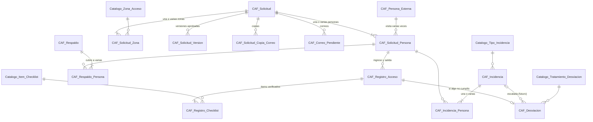

# Modelo de datos completo · Etapa 1 (visitante externo, VES)

Proyecto **Control de Accesos** · V2.1 · 2026-10-16
Estado: **BORRADOR para revisión**. Todos los scripts (01 a 08) están probados en PostgreSQL 16 y los scripts 01 a 05 también en PostgreSQL 18. Se aprueba el modelo entero, pero se construye hito por hito.

## 1. Las 31 tablas en una vista

| Schema | Hito | Script | Tablas |
| --- | --- | --- | --- |
| `CAF_GOVERNANCE` | 0 | 02 | `Catalogo_Sede`, `Catalogo_Area`, `Catalogo_Cargo`, `Catalogo_Tipo_Documento`, `Catalogo_Empresa_Grupo`, `Catalogo_Licencia`, `Personal`, `Usuario`, `Usuario_Licencia` (9) |
| `TRIANONSATELITAL_CAF_PRODD` | 1 | 03, 04 | `Catalogo_Tipo_Acceso`, `Catalogo_Zona_Acceso`, `Catalogo_Motivo_Visita`, `Catalogo_Tratamiento_Desviacion`, `Catalogo_Tipo_Incidencia`, `Catalogo_Item_Checklist`, `Tipo_Acceso_Item_Checklist`, `CAF_Persona_Externa` (8) |
| `TRIANONSATELITAL_CAF_PRODD` | 2 | 06 | `CAF_Solicitud`, `CAF_Solicitud_Version`, `CAF_Solicitud_Zona`, `CAF_Solicitud_Persona`, `CAF_Solicitud_Copia_Correo`, `CAF_Evento` (6) |
| `TRIANONSATELITAL_CAF_PRODD` | 3 | 07 | `CAF_Registro_Acceso`, `CAF_Registro_Checklist`, `CAF_Respaldo`, `CAF_Respaldo_Persona`, `CAF_Desviacion` (5) |
| `TRIANONSATELITAL_CAF_PRODD` | 4 | 08 | `CAF_Incidencia`, `CAF_Incidencia_Persona`, `CAF_Correo_Pendiente` (3) |

## 2. Cómo se relacionan las tablas transaccionales

La pieza central es **`CAF_Solicitud_Persona`**: un visitante dentro de una visita concreta. La aprobación vive en `CAF_Solicitud`; todo lo que ocurre en la puerta cuelga de cada persona.

`CAF_Evento` (bitácora) no se dibuja: registra acciones sobre todas las demás.

## 3. Cómo se guarda una visita (resultado de la prueba)

El script `MODELO_DATOS_ETAPA1_PRUEBA_RECORRIDO.sql` guarda la visita del mockup y responde cuatro preguntas. Termina en `ROLLBACK`, así que no deja datos.

| Paso | Qué se escribe |
| --- | --- |
| Carlos crea y envía | 1 `CAF_Solicitud` (PENDIENTE), 2 `CAF_Solicitud_Zona`, 2 `CAF_Solicitud_Persona` (ESPERADA), 1 `CAF_Correo_Pendiente`, 1 `CAF_Evento` |
| Roberto aprueba | `CAF_Solicitud` → APROBADA, 1 `CAF_Solicitud_Version`, 1 `CAF_Evento` |
| Luis ingresa con SCTR vencido | 1 `CAF_Registro_Acceso` (INGRESA_RESTRINGIDO), 7 `CAF_Registro_Checklist` (SCTR = N), 1 `CAF_Desviacion`; su persona → DENTRO, restringida |
| Ana ingresa con herramientas | 1 `CAF_Registro_Acceso`, 7 checklist, 1 `CAF_Respaldo` (guía manual) + 1 `CAF_Respaldo_Persona`; Trae_Herramientas = Y |
| Incidencia sobre Luis | 1 `CAF_Incidencia` (REGISTRADA) + 1 `CAF_Incidencia_Persona` |
| Ana sale | 1 `CAF_Registro_Acceso` (SALE), 5 checklist de salida (incluye herramientas); su persona → SALIO |

Respuestas obtenidas:

- **¿Quién estuvo autorizado a entrar a Producto terminado el 08/10?** Ana Vargas, sí (09:04-11:42). Luis Torres figura en la solicitud, pero estaba restringido a zona administrativa: es justamente la incidencia registrada.
- **Reporte del día:** 3 movimientos con vigilante, resultado y código de desviación (el G-FSCA-008 sale de una consulta, sin tabla propia).
- **Desviaciones por revisar:** DES con el ítem incumplido (SCTR vigente), la decisión y el resultado.
- **Estado por persona:** Luis DENTRO con INC (REGISTRADA); Ana SALIÓ, con herramientas.

## 3-bis. Ampliación del script 09: permisos y pasos de aprobación

El 16/10/2026 se agregaron 4 tablas para que el sistema admita los flujos que vienen (contratista, proveedor, personal interno visitante) sin rehacer nada. **El visitante externo no cambia**: es el caso de un solo paso de aprobación.

| Schema | Tabla | Para qué |
| --- | --- | --- |
| `CAF_GOVERNANCE` | `Catalogo_Permiso` | Los 13 permisos del sistema. Se cargan por script; el código pregunta por permiso, nunca por el nombre del rol |
| `CAF_GOVERNANCE` | `Licencia_Permiso` | Qué permisos tiene cada rol. Se edita desde la pantalla de administración |
| `TRIANONSATELITAL_CAF_PRODD` | `Tipo_Acceso_Paso_Aprobacion` | Los pasos de aprobación de cada tipo de acceso: orden, rol que decide, si es por persona o por solicitud |
| `TRIANONSATELITAL_CAF_PRODD` | `CAF_Solicitud_Decision` | Una fila por persona y paso: la decisión, quién y cuándo |

Columnas agregadas a tablas que ya existían:

| Tabla | Columnas | Para qué |
| --- | --- | --- |
| `CAF_Solicitud_Persona` | `Aprobacion`, `Aprobacion_Mensaje`, `ID_Usuario_Aprobacion`, `Fecha_Aprobacion`, `Origen` | Resumen de las decisiones de esa persona, que es lo que leen Vigilancia y las pantallas |
| `CAF_Solicitud` | `ID_Solicitud_Origen` y dos estados más (`APROBADA_PARCIAL`, `RECHAZADA`) | Trazabilidad de «Reutilizar» y el estado calculado desde las personas |
| `Catalogo_Licencia` | `Es_Sistema` | Marca el rol Administrador, que el código da por supuesto |
| `CAF_Evento` | Entidad `SOLICITUD_DECISION` | Registrar en la bitácora cada decisión |

Reglas que la base hace cumplir sola, probadas el 16/10/2026:

- Una persona **observada o rechazada** debe decir por qué: el solicitante siempre ve el motivo.
- **Nadie entra sin estar aprobado**: el estado de portería solo cambia si la aprobación es `APROBADA`.
- Un tipo de acceso **disponible** no puede quedarse sin ningún paso de aprobación obligatorio.
- El sistema nunca queda **sin un rol que administre usuarios**.

Cómo se calcula la aprobación de una persona, en un único procedimiento: aprobada si todos los pasos obligatorios que le aplican están aprobados; rechazada si alguno lo rechazó; observada si alguno la observó; pendiente en los demás casos. Con un solo paso, el resultado es idéntico al modelo anterior.

## 3-ter. Procedimientos de escritura del Hito 2

Probados con `PRUEBAS_FASE1_HITO2_ESCRITURA.sql` (186 pruebas). Las lecturas (listados, detalle, historial) son la segunda parte de la Fase 1 del Hito 2.

| Procedimiento | Qué hace | Quién puede |
| --- | --- | --- |
| `ERP_CAF_SOLICITUD_CREAR` | Crea y envía a aprobación; también «Reutilizar» (con la solicitud de origen) | Solicitante, con `PER_CAF_SOLICITUD_PROPIA` |
| `ERP_CAF_SOLICITUD_EDITAR_DATOS` | Cambia los datos de la visita; reabre la aprobación solo si cambió algo que altera lo autorizado | El solicitante dueño |
| `ERP_CAF_SOLICITUD_CANCELAR` | Cancela (nunca se borra); avisa a aprobadores y portería si había autorizados | El solicitante dueño |
| `ERP_CAF_SOLICITUD_PERSONA_AGREGAR` | Agrega o reactiva (misma fila) a una persona; nace Pendiente | El solicitante dueño |
| `ERP_CAF_SOLICITUD_PERSONA_AGREGAR_EMERGENCIA` | Corrección de emergencia (D-169): agrega a quien llegó sin estar a una solicitud ya aprobada, hasta el día de la visita, con sustento obligatorio; avisa al solicitante y a Vigilancia | Quien tenga `PER_CAF_SOLICITUD_APROBAR` y rol en el flujo |
| `ERP_CAF_SOLICITUD_PERSONA_RETIRAR_EMERGENCIA` | Corrección de emergencia: retira a una persona autorizada que aún no ingresó (nunca a la última); sustento obligatorio | Quien tenga `PER_CAF_SOLICITUD_APROBAR` y rol en el flujo |
| `ERP_CAF_SOLICITUD_PERSONA_RETIRAR` | Retira (no se borra); no se retira a la última persona | El solicitante dueño |
| `ERP_CAF_SOLICITUD_PERSONA_CORREGIR` | Corrige y, si estaba observada, reenvía | El solicitante dueño |
| `ERP_CAF_SOLICITUD_DECIDIR` | Aprueba, observa o rechaza personas en un paso | Quien tenga el permiso **y** el rol al que le toca ese paso |

Piezas internas (`SP_CAF_SOLICITUD_BASE_ALL.sql`): bitácora con único escritor, bandeja de correos, cálculo de destinatarios, herencia de pasos, **recálculo de la aprobación** (la única pieza que escribe `Aprobacion` y `Estado`) y la foto por versión.

Códigos de respuesta: 100 correcto · 101 regla de negocio o falta de permiso · 400 dato inválido · 404 no existe · 409 estado que no lo permite · 500 error técnico.

## 4. Decisiones nuevas del modelo completo

Continúan la numeración del paquete de los Hitos 0 y 1.

| # | Decisión | Motivo |
| --- | --- | --- |
| D-13 | Los estados son códigos en mayúsculas validados con `CHECK` (`PENDIENTE`, `APROBADA`, `DENTRO`, `POR_REVISAR`…). La pantalla los muestra con texto amigable. | Valores cerrados y estables; la base impide estados inventados. |
| D-14 | `CAF_Solicitud_Version` guarda la solicitud aprobada completa como JSON (`TEXT`; `NCLOB` en HANA). | RN-08: saber qué se aprobó aunque luego se edite. Excepción justificada a "sin textos largos": no se filtra ni agrupa por ese campo. |
| D-15 | Los códigos visibles (`SOL-00036`, `DES-00018`, `INC-00004`) se derivan del ID y los asigna el procedimiento de creación. | Sin tablas de correlativos ni riesgo de números repetidos. |
| D-16 | `CAF_Evento` es inmutable: solo se inserta, sin `Eliminado` ni campos de actualización. | Una bitácora que se puede editar no sirve como evidencia (RNF-04). |
| D-17 | La visita se guarda en una sola columna `Fecha_Hora_Prevista` (`TIMESTAMP`). | Convención: fecha y hora juntas. |
| D-18 | Se copian datos para que las pantallas sean rápidas y el pasado no cambie: `Exige_SCTR`/`Exige_EPP` en la solicitud, y estado, horas y "trae equipos/herramientas" en `CAF_Solicitud_Persona`. La evidencia completa sigue en `CAF_Registro_Acceso`. | La pantalla de Vigilancia no necesita recalcular nada, y un cambio en el catálogo de zonas no altera visitas pasadas. |
| D-19 | Los correos se escriben en `CAF_Correo_Pendiente` y los envía un proceso aparte. | Si el servidor de correo falla, la aprobación no se pierde ni se revierte. |
| D-20 | Los ítems incumplidos no se repiten en `CAF_Desviacion`: son las filas `Cumple = 'N'` de su checklist. Se guardan todos los ítems mostrados, cumplan o no. | Un solo lugar para cada dato; además se sabe qué se verificó, no solo qué falló. |
| D-21 | Un ingreso denegado también es un `CAF_Registro_Acceso` (`Resultado = NO_INGRESA`). | La persona sí llegó a la puerta; ese hecho debe quedar registrado. |
| D-22 | Las incidencias apuntan a la persona **en esa visita** (`CAF_Solicitud_Persona`), no a la persona en general. | Se sabe en qué visita ocurrió la falta. |
| D-41 | Los permisos son atómicos y fijos (se cargan por script); un rol es un conjunto de permisos y se edita como dato. El código pregunta por permiso, nunca por el nombre del rol. | Un aprobador de almacén no debe heredar las pantallas del Coordinador. Un rol nuevo deja de requerir programación. |
| D-42 | Cada tipo de acceso define sus **pasos de aprobación** como datos: orden (los del mismo orden corren en paralelo), rol que decide, si es obligatorio y si el alcance es por persona o por solicitud. | Contratistas y proveedores necesitan más de un aprobador. El visitante externo es el caso de un paso, así que nada cambia hoy. |
| D-43 | La decisión vive en `CAF_Solicitud_Decision` (una por persona y paso). Las decisiones anteriores quedan con `Vigente = 'N'`, nunca se borran. | Reconstruir qué se aprobó y cuándo, aunque la solicitud se reabra. |
| D-44 | El estado de la solicitud y la aprobación de cada persona se **calculan** en un único procedimiento; las columnas resumen solo se escriben allí. | Dos lugares que calculan lo mismo terminan contradiciéndose. |
| D-45 | Las columnas de decisión de `CAF_Solicitud` quedan como resumen de la **última** decisión, no como la aprobación en sí. | Evita renombrar columnas en una tabla ya creada. |
| D-46 | `Tipo_Aprobador` y `Condicion` tienen hoy un solo valor permitido (`ROL`, `SIEMPRE`). Ampliarlos es un cambio pequeño y localizado. | Deja la puerta abierta a «el jefe del solicitante» (P-16) y a condiciones nuevas, sin construirlo ahora. |
| D-47 | Las listas (zonas, personas, correos en copia, personas a decidir) viajan como **texto separado por comas** y se validan contra el catálogo contando coincidencias: si un identificador no existe, se rechaza todo. | HANA no recibe arreglos como parámetro. Sin cursores ni tablas temporales, la misma técnica sirve en los dos motores. |
| D-48 | Cada operación de escritura es **atómica**. En PostgreSQL lo garantiza el bloque de manejo de errores (revierte lo hecho dentro del procedimiento). En HANA **no es automático**: la aplicación debe ejecutar el procedimiento dentro de una transacción y revertirla si el código de respuesta es 500. | Una persona aprobada a medias o una solicitud sin personas serían datos corruptos. Riesgo anotado como tarea T-05. |
| D-49 | Cada operación sobre una solicitud toma primero un **bloqueo de su fila** (un `UPDATE` que no cambia nada). | Si dos aprobadores deciden a la vez, el segundo espera y ve lo ya registrado. No existe un índice único para «una decisión vigente por persona y paso» porque HANA no admite índices parciales. |
| D-50 | **No se retira a la última persona** de una solicitud: se cancela la solicitud. | Una solicitud sin personas no tiene sentido. **Difiere del prototipo**, que lo permitía y mostraba «sin personas». Por confirmar (T-07). |
| D-51 | La **versión** de la solicitud sube solo si cambia algo que altera lo autorizado (fecha, hora, empresa, motivo, zonas). Hay una foto por versión; cada decisión de esa versión la actualiza. | Responder «qué estaba aprobado a esa hora» sin llenar la tabla de copias casi idénticas (RN-08). |
| D-52 | Al reabrir por un cambio de datos: las aprobadas y pendientes vuelven a Pendiente (origen `REABIERTA`); las **observadas conservan su observación**; las rechazadas y retiradas no se reabren; los pasos por solicitud se invalidan para todas. | Una observación depende del solicitante, no de los datos de la visita. |
| D-53 | Un paso por solicitud se decide sobre las personas **pendientes que aún no lo tienen**. Quien llega después **hereda** los pasos por solicitud ya aprobados; una persona observada recibe el paso cuando se reenvíe. | El área que ya aprobó el servicio no vuelve a aprobarlo por cada persona nueva. |
| D-54 | Tres funciones escalares (`ERP_CAF_FN_USUARIO_TIENE_PERMISO`, `_TIENE_ROL`, `ERP_CAF_FN_COPIAS_VALIDAS`) centralizan preguntas que se repiten en todos los procedimientos. | Una sola consulta por pregunta, en lugar de copiarla doce veces. |
| D-55 | La falta de permiso responde código **101**, no uno nuevo. | La convención de Trianon define 100, 101, 400, 404, 409 y 500, y la aplicación ya traduce esos códigos. |
| D-23 | La combinación válida de `Entidad` + `Accion` en `CAF_Evento` se valida en un único procedimiento, `ERP_CAF_EVENTO_REGISTRAR`, que todos los demás llaman para escribir en la bitácora. La tabla solo controla `Entidad` con su `CHECK`. La matriz de combinaciones está documentada en el script 06. | Decisión del usuario: no agregar una tabla de catálogo para esto. Al vivir la regla en un solo procedimiento, no se repite ni se desincroniza. |

## 5. Cómo probarlo

Sobre la base donde ya ejecutaste 01 a 05:

1. Ejecutar en orden `06_CAF_SOLICITUD.sql` (carpeta del Hito 2), `07_CAF_PORTERIA.sql` (Hito 3) y `08_CAF_INCIDENCIAS_CORREOS.sql` (Hito 4).
2. Ejecutar `MODELO_DATOS_ETAPA1_PRUEBA_RECORRIDO.sql` con `psql` (usa `\echo` para separar las respuestas). En pgAdmin, borrar las líneas `\echo` y ejecutar cada `SELECT` por separado antes del `ROLLBACK`.
3. Resultado esperado: 22 tablas en `TRIANONSATELITAL_CAF_PRODD`, las cuatro respuestas de la sección 3 y, al final, 0 filas en `CAF_Solicitud`.

## 6. Qué revisar antes de aprobar

- ¿Falta algún dato que la pantalla o el reporte necesiten? Compárese con el mockup y con el G-FSCA-008.
- ¿Algún estado o resultado no coincide con cómo trabaja Vigilancia?
- `Empresa_Visitante` es texto libre. Un catálogo de empresas externas puede llegar con los contratistas (etapa 2).
- Pendientes que no bloquean: listas reales de catálogos, longitudes de documentos y ajustes D-10 y D-11 del mockup.
