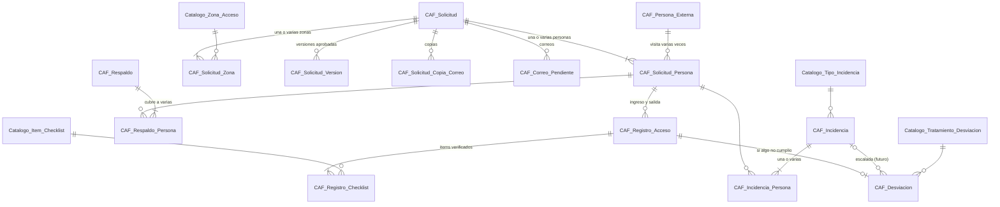

# Modelo de datos completo · Etapa 1 (visitante externo, VES)

Proyecto **Control de Accesos** · V1.0 · 2026-10-09
Estado: **BORRADOR para revisión**. Todos los scripts (01 a 08) están probados en PostgreSQL 16 y los scripts 01 a 05 también en PostgreSQL 18. Se aprueba el modelo entero, pero se construye hito por hito.

## 1. Las 31 tablas en una vista

| Schema | Hito | Script | Tablas |
| --- | --- | --- | --- |
| `CAF_GOVERNANCE` | 0 | 02 | `Catalogo_Sede`, `Catalogo_Area`, `Catalogo_Cargo`, `Catalogo_Tipo_Documento`, `Catalogo_Empresa_Grupo`, `Catalogo_Licencia`, `Personal`, `Usuario`, `Usuario_Licencia` (9) |
| `TRIANONSATELITAL_CAF_PRODD` | 1 | 03, 04 | `Catalogo_Tipo_Acceso`, `Catalogo_Zona_Acceso`, `Catalogo_Motivo_Visita`, `Catalogo_Tratamiento_Desviacion`, `Catalogo_Tipo_Incidencia`, `Catalogo_Item_Checklist`, `Tipo_Acceso_Item_Checklist`, `CAF_Persona_Externa` (8) |
| `TRIANONSATELITAL_CAF_PRODD` | 2 | 06 | `CAF_Solicitud`, `CAF_Solicitud_Version`, `CAF_Solicitud_Zona`, `CAF_Solicitud_Persona`, `CAF_Solicitud_Copia_Correo`, `CAF_Evento` (6) |
| `TRIANONSATELITAL_CAF_PRODD` | 3 | 07 | `CAF_Registro_Acceso`, `CAF_Registro_Checklist`, `CAF_Respaldo`, `CAF_Respaldo_Persona`, `CAF_Desviacion` (5) |
| `TRIANONSATELITAL_CAF_PRODD` | 4 | 08 | `CAF_Incidencia`, `CAF_Incidencia_Persona`, `CAF_Correo_Pendiente` (3) |

## 2. Cómo se relacionan las tablas transaccionales

La pieza central es **`CAF_Solicitud_Persona`**: un visitante dentro de una visita concreta. La aprobación vive en `CAF_Solicitud`; todo lo que ocurre en la puerta cuelga de cada persona.

`CAF_Evento` (bitácora) no se dibuja: registra acciones sobre todas las demás.

## 3. Cómo se guarda una visita (resultado de la prueba)

El script `MODELO_DATOS_ETAPA1_PRUEBA_RECORRIDO.sql` guarda la visita del mockup y responde cuatro preguntas. Termina en `ROLLBACK`, así que no deja datos.

| Paso | Qué se escribe |
| --- | --- |
| Carlos crea y envía | 1 `CAF_Solicitud` (PENDIENTE), 2 `CAF_Solicitud_Zona`, 2 `CAF_Solicitud_Persona` (ESPERADA), 1 `CAF_Correo_Pendiente`, 1 `CAF_Evento` |
| Roberto aprueba | `CAF_Solicitud` → APROBADA, 1 `CAF_Solicitud_Version`, 1 `CAF_Evento` |
| Luis ingresa con SCTR vencido | 1 `CAF_Registro_Acceso` (INGRESA_RESTRINGIDO), 7 `CAF_Registro_Checklist` (SCTR = N), 1 `CAF_Desviacion`; su persona → DENTRO, restringida |
| Ana ingresa con herramientas | 1 `CAF_Registro_Acceso`, 7 checklist, 1 `CAF_Respaldo` (guía manual) + 1 `CAF_Respaldo_Persona`; Trae_Herramientas = Y |
| Incidencia sobre Luis | 1 `CAF_Incidencia` (REGISTRADA) + 1 `CAF_Incidencia_Persona` |
| Ana sale | 1 `CAF_Registro_Acceso` (SALE), 5 checklist de salida (incluye herramientas); su persona → SALIO |

Respuestas obtenidas:

- **¿Quién estuvo autorizado a entrar a Producto terminado el 08/10?** Ana Vargas, sí (09:04-11:42). Luis Torres figura en la solicitud, pero estaba restringido a zona administrativa: es justamente la incidencia registrada.
- **Reporte del día:** 3 movimientos con vigilante, resultado y código de desviación (el G-FSCA-008 sale de una consulta, sin tabla propia).
- **Desviaciones por revisar:** DES con el ítem incumplido (SCTR vigente), la decisión y el resultado.
- **Estado por persona:** Luis DENTRO con INC (REGISTRADA); Ana SALIÓ, con herramientas.

## 4. Decisiones nuevas del modelo completo

Continúan la numeración del paquete de los Hitos 0 y 1.

| # | Decisión | Motivo |
| --- | --- | --- |
| D-13 | Los estados son códigos en mayúsculas validados con `CHECK` (`PENDIENTE`, `APROBADA`, `DENTRO`, `POR_REVISAR`…). La pantalla los muestra con texto amigable. | Valores cerrados y estables; la base impide estados inventados. |
| D-14 | `CAF_Solicitud_Version` guarda la solicitud aprobada completa como JSON (`TEXT`; `NCLOB` en HANA). | RN-08: saber qué se aprobó aunque luego se edite. Excepción justificada a "sin textos largos": no se filtra ni agrupa por ese campo. |
| D-15 | Los códigos visibles (`SOL-00036`, `DES-00018`, `INC-00004`) se derivan del ID y los asigna el procedimiento de creación. | Sin tablas de correlativos ni riesgo de números repetidos. |
| D-16 | `CAF_Evento` es inmutable: solo se inserta, sin `Eliminado` ni campos de actualización. | Una bitácora que se puede editar no sirve como evidencia (RNF-04). |
| D-17 | La visita se guarda en una sola columna `Fecha_Hora_Prevista` (`TIMESTAMP`). | Convención: fecha y hora juntas. |
| D-18 | Se copian datos para que las pantallas sean rápidas y el pasado no cambie: `Exige_SCTR`/`Exige_EPP` en la solicitud, y estado, horas y "trae equipos/herramientas" en `CAF_Solicitud_Persona`. La evidencia completa sigue en `CAF_Registro_Acceso`. | La pantalla de Vigilancia no necesita recalcular nada, y un cambio en el catálogo de zonas no altera visitas pasadas. |
| D-19 | Los correos se escriben en `CAF_Correo_Pendiente` y los envía un proceso aparte. | Si el servidor de correo falla, la aprobación no se pierde ni se revierte. |
| D-20 | Los ítems incumplidos no se repiten en `CAF_Desviacion`: son las filas `Cumple = 'N'` de su checklist. Se guardan todos los ítems mostrados, cumplan o no. | Un solo lugar para cada dato; además se sabe qué se verificó, no solo qué falló. |
| D-21 | Un ingreso denegado también es un `CAF_Registro_Acceso` (`Resultado = NO_INGRESA`). | La persona sí llegó a la puerta; ese hecho debe quedar registrado. |
| D-22 | Las incidencias apuntan a la persona **en esa visita** (`CAF_Solicitud_Persona`), no a la persona en general. | Se sabe en qué visita ocurrió la falta. |
| D-23 | La combinación válida de `Entidad` + `Accion` en `CAF_Evento` se valida en un único procedimiento, `ERP_CAF_EVENTO_REGISTRAR`, que todos los demás llaman para escribir en la bitácora. La tabla solo controla `Entidad` con su `CHECK`. La matriz de combinaciones está documentada en el script 06. | Decisión del usuario: no agregar una tabla de catálogo para esto. Al vivir la regla en un solo procedimiento, no se repite ni se desincroniza. |

## 5. Cómo probarlo

Sobre la base donde ya ejecutaste 01 a 05:

1. Ejecutar en orden `06_CAF_SOLICITUD.sql` (carpeta del Hito 2), `07_CAF_PORTERIA.sql` (Hito 3) y `08_CAF_INCIDENCIAS_CORREOS.sql` (Hito 4).
2. Ejecutar `MODELO_DATOS_ETAPA1_PRUEBA_RECORRIDO.sql` con `psql` (usa `\echo` para separar las respuestas). En pgAdmin, borrar las líneas `\echo` y ejecutar cada `SELECT` por separado antes del `ROLLBACK`.
3. Resultado esperado: 22 tablas en `TRIANONSATELITAL_CAF_PRODD`, las cuatro respuestas de la sección 3 y, al final, 0 filas en `CAF_Solicitud`.

## 6. Qué revisar antes de aprobar

- ¿Falta algún dato que la pantalla o el reporte necesiten? Compárese con el mockup y con el G-FSCA-008.
- ¿Algún estado o resultado no coincide con cómo trabaja Vigilancia?
- `Empresa_Visitante` es texto libre. Un catálogo de empresas externas puede llegar con los contratistas (etapa 2).
- Pendientes que no bloquean: listas reales de catálogos, longitudes de documentos y ajustes D-10 y D-11 del mockup.
